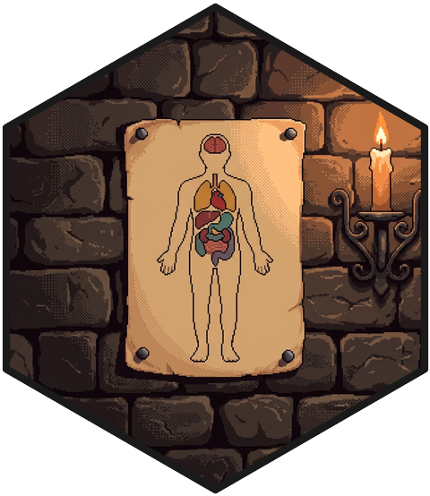
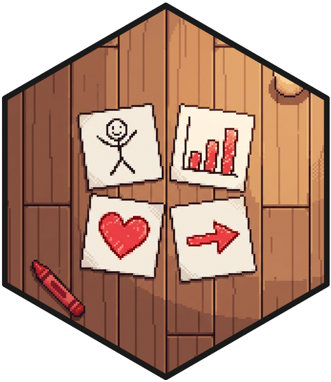

::: {.hex-mark}
{fig-alt="Pixel-art hex sticker: a workbench crowded with tools and potion flasks, a glowing hexagonal talisman at its center."}
:::

Side projects: dashboards, tooling, and the occasional over-engineered solution to a problem nobody asked me to solve. Everything is built in R unless noted, and everything is open, so you can see exactly how over-engineered.

::: {.project}
::: {.hex-mark .hex-mark--section .hex-mark--left}
{fig-alt="Pixel-art hex sticker: a brass scale of justice standing level on a leather law book, a police cap in one pan and a firefighter's helmet in the other, a blue awareness ribbon tied to the post, a lit candle behind."}
:::

<h3><a href="https://github.com/ALERRT-Research/PROJ_presumptive_laws">Presumptive Laws Dashboard</a></h3>under construction

A state-by-state history of first responder presumptive workers' compensation laws: which conditions get presumed work-related, for whom, and since when. Every claim is traced to the statute itself, not to somebody's summary of it. Fifty scattered laws in one place, so nobody else has to do what I did to build it.

R · Quarto · Shiny <a href="https://github.com/ALERRT-Research/PROJ_presumptive_laws"> source</a>

:::

::: {.project}
::: {.hex-mark .hex-mark--section .hex-mark--left}
{fig-alt="Pixel-art hex sticker: an anatomical chart on aged parchment tacked to a stone wall, a human outline with each organ inked as a separately colored shape, lit by a candle on an iron bracket."}
:::

<h3><a href="https://github.com/petertanksley/anatomogramdata">anatomogramdata</a></h3>R package

Human body maps (anatomograms) as tidy polygon data for ggplot2. It is an update of Jesper Maag's excellent [gganatogram](https://github.com/jespermaag/gganatogram), the package that first brought the EBI Expression Atlas anatomograms into R and ggplot2. I needed an anatomogram for mortality surveillance work on cancer sites and wanted to bring that work up to date: the polygons are traced fresh from the current EBI drawings, and every organ is tagged with its ontology ID and organ system. The whole thing is the intellectual godchild of gganatogram, and the code was written almost entirely by Claude, so I can't take intellectual credit for the idea or the work.

R · ggplot2 <a href="https://petertanksley.github.io/anatomogramdata/"> docs</a><a href="https://github.com/petertanksley/anatomogramdata"> source</a>

:::

::: {.project}
::: {.hex-mark .hex-mark--section .hex-mark--left}
{fig-alt="Pixel-art hex sticker: a cheerful human skull in crooked round reading glasses, jaw open mid-joke and eye sockets glowing a soft amber, resting on a stack of leather ledgers between a lit candle and a brass hourglass."}
:::

<h3><a href="https://github.com/petertanksley/bob-scheduler">Bob</a></h3>Claude Code skill

A `/bob` command and agent for Claude Code that keeps a whole portfolio of research projects in view. Each project carries a small status card. Bob reads all of them, weighs deadlines against the calendar and against how much each project actually matters, and runs short daily, weekly, and monthly planning check-ins. It does no research and writes no code. It tells you where things stand, and which important project a loud deadline is quietly starving. Named for the skull in the Dresden Files, and every bit as smug about it.

Claude Code · Python · Markdown <a href="https://github.com/petertanksley/bob-scheduler"> source</a>

:::

::: {.project}
::: {.hex-mark .hex-mark--section .hex-mark--left}
{fig-alt="Pixel-art hex sticker: four paper napkins laid out in a loose grid on a plank table like a storyboard, each with a crayon drawing: a stick figure, a rising red bar chart, a red heart, and a red arrow, with a red crayon nearby."}
:::

<h3><a href="https://github.com/petertanksley/carpe-audience">Carpe Audience</a></h3>Claude Code skill

A Claude Code skill that builds, converts, and audits research talks in the style of John-Michael Keyes's [*Carpe Audience*](https://iloveuguys.org/downloads/Carpe-Audience.pdf): seven words on a slide, no bullets, white type on black, and the speaker carrying the story. It drafts the talk as stories before any slide exists, builds the deck, and then audits the rendered slides against the book, page citations included. Every number on screen traces back to the results file it came from. It cannot, sadly, make you rehearse.

Claude Code · R · Quarto <a href="https://github.com/petertanksley/carpe-audience"> source</a>

:::

::: {.project}
::: {.hex-mark .hex-mark--section .hex-mark--left}
{fig-alt="Pixel-art hex sticker: a toy futuristic motorcycle on a candlelit workbench, its glowing cyan light trail running in right angles across the wood to two identical wooden chess pawns."}
:::

<h3><a href="https://petertanksley.github.io/path-tracer/">Path Tracer</a></h3>under construction

Explainer videos on the methods behind biosocial science, dressed up as a light-cycle video game for reasons I decline to examine. Each big topic is a realm (evolution, twins, genomes, penalized regression, DNA methylation), each episode is a sector, and the advanced material waits in a Legendary tier at the end. The house style borrows StatQuest's patience and 3Blue1Brown's pictures: every symbol gets a picture before it gets notation. It is an evenings-and-weekends project, so most of the map is still dark, and you can watch it light up one sector at a time.

Python · Manim · R · Quarto <a href="https://petertanksley.github.io/path-tracer/"> play</a><a href="https://github.com/petertanksley/path-tracer"> source</a>

:::

